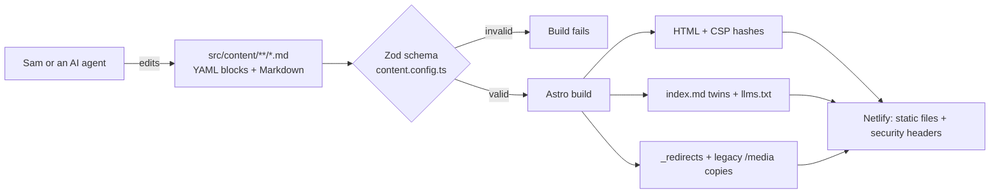

# sammullins.co.uk

Source for [www.sammullins.co.uk](https://www.sammullins.co.uk/): a static [Astro](https://astro.build) site where every page is a typed list of blocks in Markdown front matter. It's written largely by AI agents and always reviewed and merged by a human.

> **Licensing:** the **code** is [MIT](LICENSE), so reuse it freely. The **content** (words, photos, CV, logo and other creative material) is © Sam Mullins, all rights reserved; see [LICENSE-CONTENT.md](LICENSE-CONTENT.md) for exactly what that covers. Forks are welcome: replace the content with your own before publishing.

## Quick start

```bash
corepack enable
pnpm install --frozen-lockfile
pnpm dev            # http://localhost:4321
pnpm build          # static site in dist/ (first build ~5 min while images are generated, then cached)
pnpm test           # legacy URLs, hygiene and twin checks (run after build)
pnpm lint           # ESLint (Astro, jsx-a11y, TypeScript) + Prettier
pnpm test:a11y      # axe WCAG 2.2 AA on every page, light + dark, 320px overflow
```

Requires Node 24.16 or newer on the 24 line (see `.nvmrc`) and pnpm 10.

## How it works



- **Content model:** pages, articles (including short notes), software/docs and photo albums, each a list of blocks: `hero`, `intro`, `prose`, `body`, `callout`, `image`, `gallery`, `cards`, `listing`, `logoWall`, `quote`, `code`, `nextPrev`, `timeline`, `embed`, `split`, plus `section` to group blocks into one band. Reference: [`_docs/content-model.md`](_docs/content-model.md).
- **URLs never break:** file paths mirror URLs; renames need a redirect in `src/data/redirects.json`. CI proves every legacy page and media URL still resolves.
- **Security:** static output only, a strict per-page CSP, no third-party scripts or fonts, minimal dependencies with a 7-day release-age delay, and SHA-pinned Actions. See [SECURITY.md](SECURITY.md).
- **Agent view:** every page has a Markdown twin at `<url>index.md`, plus `/llms.txt`.

## How AI writes this site

1. [`AGENTS.md`](AGENTS.md) holds the house rules for any agent: content model, voice, URL rules, and **Sam merges, nothing is automatic**. `CLAUDE.md` just imports it.
2. Agent Skills in [`.agents/skills/`](.agents/skills) (`new-article`, `new-note`, `new-page`, `add-images`, `redirect`), mirrored to `.claude/skills/` for Claude Code.
3. The agent works on a branch and opens a PR. CI runs the schema, build, URL, hygiene and accessibility checks, and Netlify builds a preview.
4. Sam reviews the preview and merges.

The rebuild itself was planned and executed as tickets: see [`_tasks/`](_tasks/README.md) and the decisions record in [`_docs/decisions.md`](_docs/decisions.md).

## Repo map

| Path                                             | What                                                        |
| ------------------------------------------------ | ----------------------------------------------------------- |
| `src/content/`                                   | All content (`pages/`, `articles/`, `software/`, `albums/`) |
| `src/content.config.ts`                          | The schema: every field and block                           |
| `src/blocks/`, `src/components/`, `src/layouts/` | Rendering                                                   |
| `src/assets/media/`                              | AVIF image masters                                          |
| `src/data/`                                      | `site.yaml` (nav, socials, flags), `redirects.json`         |
| `integrations/`                                  | Build hooks (`_redirects`, legacy media)                    |
| `scripts/`                                       | Media conversion, skills tooling, one-shot migration        |
| `tests/`                                         | Node test suites and the axe runner                         |
| `_tasks/`, `_docs/`                              | Tickets, decisions, audit, guides                           |

## Glossary

Plain-English definitions of the tools and terms used above and across the repo.

| Term                     | What it means here                                                                                                                                                          |
| ------------------------ | --------------------------------------------------------------------------------------------------------------------------------------------------------------------------- |
| **Agent Skill**          | A folder of instructions (a `SKILL.md` plus helpers) that tells an AI agent how to do one job, such as writing a new article. Lives in `.agents/skills/`.                   |
| **AGENTS.md**            | A shared convention: a Markdown file of house rules that AI coding agents read before working in a repo.                                                                    |
| **Astro**                | The framework that builds the site. It turns the Markdown content and `.astro` components into plain HTML at build time, so no JavaScript framework runs in the browser.    |
| **AVIF**                 | A modern image format with much smaller files than JPEG at the same quality. Image masters are stored as AVIF and Astro generates the other sizes from them.                |
| **axe**                  | An automated accessibility checker. `pnpm test:a11y` runs it against every built page in a real browser.                                                                    |
| **Block**                | One section of a page (a hero, some prose, a gallery and so on). A page is an ordered list of blocks in its front matter.                                                   |
| **CI**                   | Continuous integration: the checks GitHub Actions runs on every pull request. A PR can't be merged until they pass.                                                         |
| **CodeQL**               | GitHub's code scanner, which looks for security bugs in the JavaScript, TypeScript and workflow files.                                                                      |
| **Conventional Commits** | A format for commit messages and PR titles, such as `feat(blocks): add hero` or `content: new note`. CI checks that PR titles follow it.                                    |
| **Corepack**             | A tool that ships with Node. `corepack enable` makes the exact pnpm version named in `package.json` available, so everyone uses the same one.                               |
| **CSP**                  | Content Security Policy: rules telling the browser which scripts and styles a page may run. Here each page lists hashes of its own inline code and nothing else is allowed. |
| **ESLint**               | A linter: it reads the code and flags mistakes and risky patterns, including accessibility problems in markup (via `jsx-a11y`).                                             |
| **Front matter**         | The YAML block between `---` lines at the top of a Markdown file. It holds a page's title, metadata and blocks.                                                             |
| **GitHub Actions**       | GitHub's built-in automation, which runs the workflows in `.github/workflows/`.                                                                                             |
| **Lighthouse**           | Google's page auditor for performance, accessibility, best practices and SEO. CI runs it on key pages and fails if scores drop below the budgets in `lighthouserc.json`.    |
| **llms.txt**             | A proposed standard: a plain-text index of a site written for AI models to read.                                                                                            |
| **Lockfile**             | `pnpm-lock.yaml`, which records the exact version of every installed package. `--frozen-lockfile` refuses to install if it's out of date, so builds are repeatable.         |
| **Lychee**               | A link checker. CI uses it to prove no internal link is broken; a weekly job checks external links.                                                                         |
| **Markdown twin**        | A Markdown copy of each page at `<url>index.md`, so AI agents can read the content without parsing HTML.                                                                    |
| **Netlify**              | The host. It builds the site from `main`, serves the static files with the security headers in `netlify.toml`, and builds a preview for every pull request.                 |
| **Node**                 | Node.js, the JavaScript runtime that runs the build and the tests.                                                                                                          |
| **nvm / `.nvmrc`**       | nvm (Node Version Manager) switches between Node versions; `.nvmrc` names the one this repo needs.                                                                          |
| **OpenSSF Scorecard**    | An automated weekly check of the repo's security practices, such as pinned dependencies and branch protection.                                                              |
| **Playwright**           | A tool that drives a real browser from code. The accessibility tests use it to load each page in Chromium.                                                                  |
| **pnpm**                 | The package manager, a faster, stricter alternative to npm. It installs dependencies and runs the scripts in `package.json` (`pnpm dev`, `pnpm build` and so on).           |
| **Prettier**             | A code formatter that rewrites files into one consistent style, so formatting never comes up in review.                                                                     |
| **PR (pull request)**    | A proposed change on a branch, reviewed on GitHub before it's merged into `main`.                                                                                           |
| **Redirect**             | A rule that sends an old URL to its new home. Listed in `src/data/redirects.json` and written to Netlify's `_redirects` file at build time.                                 |
| **Release-age delay**    | pnpm and Renovate won't use a package version until it has been public for 7 days, which gives time for a compromised release to be caught.                                 |
| **Renovate**             | A bot that opens pull requests to update dependencies and pinned Actions. Settings are in `renovate.json`; it never merges on its own.                                      |
| **SHA pinning**          | Referring to a GitHub Action by its full commit hash instead of a tag like `v7`, so the code behind it can't be swapped out later.                                          |
| **Static site**          | A site made of pre-built HTML, CSS and image files, with no server code running per request.                                                                                |
| **TypeScript**           | JavaScript with types. `pnpm check` (`astro check`) uses it to catch errors in components and the schema.                                                                   |
| **WCAG 2.2 AA**          | The Web Content Accessibility Guidelines, version 2.2, level AA: the accessibility standard this site is tested against.                                                    |
| **YAML**                 | A plain-text data format that uses indentation, used for front matter and `src/data/site.yaml`.                                                                             |
| **Zod**                  | A schema library. `src/content.config.ts` uses it to define every field and block, and the build fails if any content doesn't match.                                        |
