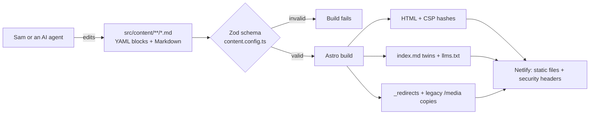

# sammullins.co.uk

Source for [www.sammullins.co.uk](https://www.sammullins.co.uk/): a static [Astro](https://astro.build) site where every page is a typed list of blocks in Markdown front matter. It's written largely by AI agents and always reviewed and merged by a human.

> **Licensing:** the **code** is [MIT](LICENSE). The **content** (words, photos, CV, images) is © Sam Mullins, all rights reserved; see [LICENSE-CONTENT.md](LICENSE-CONTENT.md).

## Quick start

```bash
corepack enable
pnpm install --frozen-lockfile
pnpm dev            # http://localhost:4321
pnpm build          # static site in dist/ (first build ~5 min while images are generated, then cached)
pnpm test           # legacy URLs, hygiene and twin checks (run after build)
pnpm test:a11y      # axe WCAG 2.2 AA on every page, light + dark, 320px overflow
```

Requires Node 24 (see `.nvmrc`) and pnpm 10.

## How it works



- **Content model:** pages, articles (including short notes), software/docs and photo albums, each a list of blocks: `hero`, `intro`, `prose`, `body`, `callout`, `image`, `gallery`, `cards`, `listing`, `logoWall`, `quote`, `code`, `nextPrev`, `timeline`, `embed`, `split`. Reference: [`_docs/content-model.md`](_docs/content-model.md).
- **URLs never break:** file paths mirror URLs; renames need a redirect in `src/data/redirects.json`. CI proves every legacy page and media URL still resolves.
- **Security:** static output only, a strict per-page CSP, no third-party scripts or fonts, minimal dependencies with a 7-day release-age delay, and SHA-pinned Actions. See [SECURITY.md](SECURITY.md).
- **Agent view:** every page has a Markdown twin at `<url>index.md`, plus `/llms.txt`.

## How AI writes this site

1. [`AGENTS.md`](AGENTS.md) holds the house rules for any agent: content model, voice, URL rules, and **Sam merges, nothing is automatic**. `CLAUDE.md` just imports it.
2. Agent Skills in [`.agents/skills/`](.agents/skills) (`new-article`, `new-note`, `new-page`, `add-images`, `redirect`), mirrored to `.claude/skills/` for Claude Code.
3. The agent works on a branch and opens a PR. CI runs the schema, build, URL, hygiene and accessibility checks, and Netlify builds a preview.
4. Sam reviews the preview and merges.

The rebuild itself was planned and executed as tickets: see [`_tasks/`](_tasks/README.md) and the decisions record in [`_docs/decisions.md`](_docs/decisions.md).

## Repo map

| Path | What |
|---|---|
| `src/content/` | All content (`pages/`, `articles/`, `software/`, `albums/`) |
| `src/content.config.ts` | The schema: every field and block |
| `src/blocks/`, `src/components/`, `src/layouts/` | Rendering |
| `src/assets/media/` | AVIF image masters |
| `src/data/` | `site.yaml` (nav, socials, flags), `redirects.json` |
| `integrations/` | Build hooks (`_redirects`, legacy media) |
| `scripts/` | Media conversion, skills tooling, one-shot migration |
| `tests/` | Node test suites and the axe runner |
| `_tasks/`, `_docs/` | Tickets, decisions, audit, guides |
